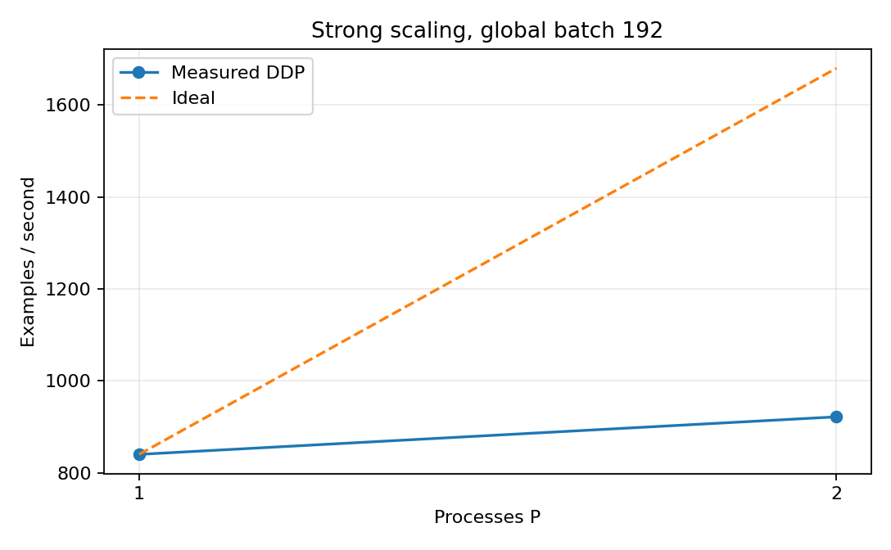
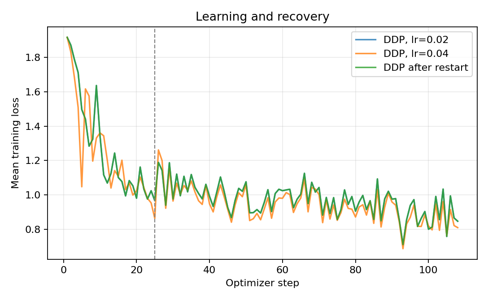

# Лабораторна робота №6

**Розподілене навчання нейромережі за даними на CPU**

Дьяченко Валерія, ЗК-61мп. Варіант 7.

## Мета

Реалізувати синхронне навчання з ручним усередненням градієнтів та DDP, перевірити масштабування і відновлення після відмови.

## 1. Дані, модель і стенд

Використано DermaMNIST 28 × 28: перші 7000 навчальних зображень і всю тестову частину з 2005 зображень, 7 класів та 3 канали. Пікселі перетворено у діапазон [−1; 1]. Val не використовується. Дані перевірено за MD5 офіційного файлу. Мережа містить Conv(3→32), ReLU, MaxPool(2), Conv(32→64), ReLU, MaxPool(2), Flatten, Linear(3136→256), ReLU, Linear(256→7), без BatchNorm та Dropout.

Зерно torch.manual_seed(0) задається перед створенням кожної моделі. Використано CPU, float32, gloo, SGD з momentum=0,9, η₀=0,02. Усі прогони мають однакове n_th=max(1,⌊C_phys/2⌋), включно з одним процесом. DataLoader працює без додаткових воркерів, з drop_last=True. DistributedSampler має seed=0; перед кожною епохою викликано set_epoch.

### Таблиця 1. Стенд

| Процесор | C_phys | Логічних ядер | RAM, ГіБ | ОС | Python | PyTorch | n_th |
| --- | --- | --- | --- | --- | --- | --- | --- |
| Intel64 Family 6 Model 142 Stepping 12, GenuineIntel | 4 | 8 | 6.958916 | Windows-10-10.0.26200-SP0 | 3.10.19 | 2.14.1+cpu | 2 |

| Датасет | K | C | c1 / c2 / h | n_params | M, МіБ | N | B | P_max |
| --- | --- | --- | --- | --- | --- | --- | --- | --- |
| DermaMNIST | 7 | 3 | 32 / 64 / 256 | 824263 | 3.144314 | 7000 | 192 | 2 |

n_params = 9·3·32 + 32 + 9·32·64 + 64 + 49·64·256 + 256 + 256·7 + 7 = 824263. M = 4·n_params байтів.

## 2. Ручна синхронізація і DDP

Ручний режим розсилає початкові параметри з rank 0 через broadcast. Після backward кожний тензор градієнта проходить all_reduce(SUM) і ділиться на P. Для перевірки взято перші 192 приклади. Однопроцесний градієнт порівняно з усередненими локальними градієнтами на індексах r, r+2, … . Окремо після рівно 50 синхронізованих кроків суми ваг у float64 зібрано через all_gather.

DDP використовує типовий розмір кошиків без зміни bucket_cap_mb. Для кожного виміру швидкості виконано 10 кроків прогріву та 50 вимірюваних кроків. t_step — медіана 50 часів rank 0; X = 50·B / t, де t — повний час цих 50 кроків. Час первинного завантаження датасету та запуску процесів не входить у замір. У X враховано повний час циклу 50 кроків, включно з отриманням батчів; t_step вимірює крок після отримання батча. no_sync виміряно в окремому прогоні зі свіжою моделлю; контекст охоплює forward і backward. Ця модель не використовується для подальшого навчання.

### Таблиця 2. Синхронізація градієнтів

| Режим | t_step, мс | Обмін на крок, мс | Частка обміну | X, прикл./с |
| --- | --- | --- | --- | --- |
| 1 процес, B=192 | 220.4248 | 0 | 0 | 810.1993 |
| 2 процеси, вручну | 201.4639 | 31.578 | 0.1567427 | 897.3219 |
| 2 процеси, DDP | 198.6242 | 5.00955 | 0.02522125 | 921.8474 |
| 2 процеси, DDP no_sync | 193.6147 | 0 | 0 | 948.5234 |

| max відносна різниця градієнтів | Різниця сум ваг | ACC, 1 процес | ACC, DDP | AUC, 1 процес | AUC, DDP |
| --- | --- | --- | --- | --- | --- |
| 7.55201e-06 | 0 | 0.6793017 | 0.6793017 | 0.8271442 | 0.8271219 |

Для ручного режиму t_sync виміряно від першого all-reduce до повернення з останнього. Для DDP t_comm,exp = t_step − t_step,ns; c = t_comm,exp / t_step. Оскільки це різниця двох окремих вимірів, невелике від’ємне значення може означати шум вимірювання; його не обрізано до нуля.

## 3. Strong scaling

Глобальний батч B=192; b=192 при P=1 і b=96 при P=2. Обидва рядки отримано через torchrun і DDP. Однопроцесний DDP є базою S та E.

### Таблиця 3. Strong scaling

| P | b | t_step, мс | t_step,ns, мс | X, прикл./с | S | E | e | c |
| --- | --- | --- | --- | --- | --- | --- | --- | --- |
| 1 | 192 | 213.25 | 221.292 | 840.1692 | 1 | 1 | — | -0.03771136 |
| 2 | 96 | 198.6242 | 193.6147 | 921.8474 | 1.097216 | 0.5486082 | 0.8227945 | 0.02522125 |

S=X(P)/X(1); E=S/P; e=(1/S−1/P)/(1−1/P). Для P=1 e не визначається.

Для P=1 різниця двох окремих вимірів становила 213,250−221,292=−8,042 мс, тому формула дала c=−0,03771. Міжпроцесного обміну при P=1 немає; це від’ємна експериментальна оцінка через варіативність часу виконання, а не фізична частка від’ємного часу зв’язку. Значення залишено за формулою, без штучного виправлення вимірів. Для P=2 неперекритий обмін оцінено у 5,010 мс, тобто 2,52 % часу кроку.

## 4. Weak scaling та швидкість навчання

Локальний батч b=96. Глобальний батч зростає від 96 до 192. Рядок P=2 повторно використано зі strong scaling. S_w=X(P)/X(1), E_w=S_w/P.

### Таблиця 4. Weak scaling

| P | B_P | t_step, мс | X, прикл./с | S_w | E_w |
| --- | --- | --- | --- | --- | --- |
| 1 | 96 | 95.1825 | 948.4758 | 1 | 1 |
| 2 | 192 | 198.6242 | 921.8474 | 0.971925 | 0.4859625 |

Моделі якості навчаються 3 епохи з однакового початкового стану. Лінійне правило: η_P=0,02·192/96=0,04, без розігріву η. Усі значення ACC та macro OVR AUC обчислено на повній тестовій частині. Loss — середня cross-entropy; у розподіленому режимі локальні втрати усереднено між процесами.

### Таблиця 5. Якість за різних глобальних батчів

| Режим | B_P | η | Кроків за 3 епохи | ACC | AUC | max loss останньої епохи |
| --- | --- | --- | --- | --- | --- | --- |
| P=1 | 96 | 0.02 | 216 | 0.6982544 | 0.8539604 | 1.112631 |
| P=2, η₀ | 192 | 0.02 | 108 | 0.6793017 | 0.8271219 | 1.092805 |
| P=2, лінійне правило | 192 | 0.04 | 108 | 0.682793 | 0.8281859 | 1.030099 |

За B=192 виконується 36 кроків за епоху і 108 за три епохи; за B=96 — 72 і 216 відповідно.

## 5. Відмова та відновлення

Контрольну точку кожні 10 кроків зберігає rank 0: ваги, стан SGD, епоха, наступний батч, глобальний крок, журнал втрат і стан генератора. Файл checkpoint.tmp атомарно замінює checkpoint.pt; після цього виконується barrier. Процес rank 1 на початку кроку 25 створює позначку і завершується через os._exit(1). torchrun використовує статичну адресу 127.0.0.1 і max-restarts=1. Після перезапуску всі процеси читають контрольну точку, відновлюють sampler.set_epoch і пропускають уже зафіксовані батчі.

### Таблиця 6. Відмова і відновлення

| K_c | s_f | Крок checkpoint | Повторно виконано кроків | t_lost, с |
| --- | --- | --- | --- | --- |
| 10 | 25 | 20 | 4 | 15.94679 |

| Крок | 23 | 24 | 25 | 26 | 27 | ACC після 3 епох |
| --- | --- | --- | --- | --- | --- | --- |
| З відмовою | 0.9756099 | 1.023836 | 0.9664584 | 1.189098 | 1.142454 | 0.6793017 |
| Без відмови | 0.9756099 | 1.023836 | 0.9664584 | 1.189098 | 1.142454 | 0.6793017 |

Відмова сталася до виконання кроку 25. Відновлено checkpoint кроку 20, тому повторно виконано кроки 21–24: чотири завершені до відмови кроки. t_f−t_c=0.675378 с; t_r=15.2714 с; t_lost=(t_f−t_c)+t_r=15.9468 с. Максимальна різниця loss між усіма відповідними кроками: 0.

## Висновок

При P=2 strong scaling дав S=1.0972, E=0.54861, e=0.82279. Частка неперекритого обміну c=0.025221. Weak scaling дав S_w=0.97193, E_w=0.48596. Ці результати характеризують баланс обчислень, синхронізації та ресурсів CPU цього вузла. Збільшення P з 1 до 2 у strong scaling підвищило X приблизно на 9,72 %, але ефективність становила лише 54,86 %. У weak scaling X зменшився приблизно на 2,81 %, тобто для цієї моделі на цьому вузлі збільшення числа процесів не забезпечило масштабованого виграшу за фіксованого локального батча.

За η=0,02 і B=96 отримано ACC=0.69825; за η=0,02 і B=192 — 0.6793; за лінійним правилом η=0,04 і B=192 — 0.682793. Порівняння виконано за однакових трьох епох; велике B зменшує число оновлень. Лінійне правило збільшило ACC порівняно з B=192 та η=0,02 приблизно на 0,35 відсоткового пункту, але не досягло ACC режиму B=96. Найбільша втрата останньої епохи з η=0,04 становила 1,0301; числового розходження в цьому прогоні не зафіксовано. Один прогін кожного режиму не дає оцінки статистичної значущості різниці якості.

Відновлення перевірено за журналом втрат і тестовою ACC; журнал відновленого прогону містить остаточну послідовність кроків без дублікатів. Усі 108 значень loss, підсумкові ACC=0,679302, AUC=0,827122 і сума ваг збіглися з прогоном без відмови. Втрачений час становив 15,947 с; основна його частина припала на зупинку, перезапуск процесів і завершення першого відновленого кроку (t_r=15,271 с).
